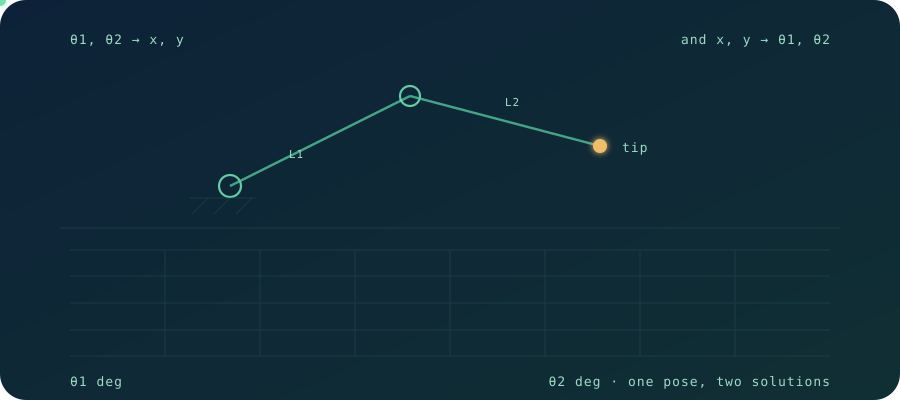

<p align="center">
  
</p>

# kin

<p align="center">
  
  
  
</p>

Forward and inverse kinematics for robot arms, in one C file.

Two questions, and this library answers both:

- **Forward** — the joints are at these angles, so where is the hand?
- **Inverse** — I want the hand *there*, so what angles do the joints need?

The first is easy maths. The second is the one people give up on and hand to a
big framework. It fits in 280 lines.

- One header, one source file. Drop them into any C project.
- Only needs `libm`. No `malloc` — works fine on a microcontroller.
- One solver for any arm. No robot-specific maths to derive.

## Try it

```sh
make check    # run the tests
make run      # run the 6-axis arm example
```

## Describing your arm

You describe a robot as a list of links, each with four numbers — the standard
**Denavit–Hartenberg** parameters. Almost every arm's datasheet or URDF gives
you these, so usually you copy them rather than work them out:

| number  | in plain words |
|---------|----------------|
| `a`     | how long the link is |
| `d`     | how far the next joint sits along the current joint's axis |
| `alpha` | how much the next joint axis is twisted relative to this one |
| `theta` | a fixed angle offset baked into the joint |

Then you say what kind of joint it is:

- `KIN_REVOLUTE` — it rotates. The value you command gets **added to `theta`**.
- `KIN_PRISMATIC` — it slides. The value you command gets **added to `d`**.

So a flat two-link arm, each link 1 metre long, with both joints rotating, is
just this:

```
        elbow
   1m  /     \  1m
      /       \
   base        hand
```

```c
static const kin_link arm2[] = {
    /*  d    a    alpha  theta  type          qmin  qmax  */
    {  0.0, 1.0,  0.0,   0.0,   KIN_REVOLUTE,  0,   0  },
    {  0.0, 1.0,  0.0,   0.0,   KIN_REVOLUTE,  0,   0  },
};
static const kin_chain arm = { arm2, 2 };   /* 2 = number of joints */
```

`qmin`/`qmax` are the joint limits. Leave both `0` for "no limit".

## Forward: where is the hand?

```c
#include "kin.h"
#include <stdio.h>

static const kin_link arm2[] = {
    { 0.0, 1.0, 0.0, 0.0, KIN_REVOLUTE, 0, 0 },
    { 0.0, 1.0, 0.0, 0.0, KIN_REVOLUTE, 0, 0 },
};

int main(void)
{
    kin_chain arm = { arm2, 2 };
    double q[2] = { 0.0, 1.5707963 };   /* straight out, then elbow up 90 deg */
    kin_mat4 pose;                      /* just a double[16] */

    kin_forward(&arm, q, pose);

    printf("hand at x=%.3f y=%.3f z=%.3f\n", pose[3], pose[7], pose[11]);
    return 0;
}
```

Prints `hand at x=1.000 y=1.000 z=0.000` — one metre out, one metre up, exactly
as the drawing says. A `kin_mat4` is a plain `double[16]`, so the position is
always at `pose[3]`, `pose[7]`, `pose[11]`.

## Inverse: what angles get me there?

Give it a target pose and a **seed** — a guess to start from, normally wherever
the arm is right now. It walks from the seed to the answer:

```c
double sol[6];
int rc = kin_inverse(&arm, target, current_q, sol, NULL);

if (rc == KIN_OK)
    /* sol now holds the joint values that reach `target` */;
```

`NULL` means "use the default settings", which is usually right.

Two things to know:

- It finds the solution **nearest your seed**. An arm can often reach the same
  point elbow-up or elbow-down; you get the one closest to where you started,
  which is normally the one you want.
- It matches position *and* orientation — six numbers. An arm with fewer than
  six joints cannot hit an arbitrary pose, and you will get `KIN_ENOCONV`.
  That is the arm's limitation, not a bug.

Returns `KIN_OK`, or `KIN_ENOCONV` if it ran out of iterations — `sol` still
holds the closest it got, so you can look at how far off it was.

Need to tune it? Every field left at `0` keeps its default:

```c
kin_inverse_opts o = { 0 };
o.max_iters = 300;    /* default 100  - try harder */
o.lambda    = 0.1;    /* default 0.05 - more damping if it oscillates */
kin_inverse(&arm, target, seed, sol, &o);
```

| field | default | what it is |
|-------|---------|------------|
| `pos_tol`   | 1e-4  | close enough, in metres |
| `rot_tol`   | 1e-4  | close enough, in radians |
| `lambda`    | 0.05  | damping — keeps it stable near awkward poses |
| `max_step`  | 0.2   | biggest joint move per iteration |
| `max_iters` | 100   | give up after this many tries |

## Building a target pose

A pose is a 4x4 matrix, which is a nuisance to write by hand, so:

```c
kin_mat4 target;
kin_pose(0.4, 0.1, 0.3,  0.0, 1.5708, 0.0, target);   /* x y z  roll pitch yaw */

double p[6];
kin_pose_decompose(target, p);      /* back out: x y z roll pitch yaw */
```

Rotation order is yaw, then pitch, then roll.

## The functions

```c
kin_forward(&arm, q, pose);              /* joints  -> pose */
kin_inverse(&arm, target, seed, q, opts);/* pose    -> joints */
kin_jacobian(&arm, q, J);                /* how the hand moves per joint move */
kin_pose(x,y,z, roll,pitch,yaw, out);
kin_pose_decompose(pose, xyzrpy);
```

`kin_jacobian` is there because the solver computes it anyway. If you are doing
velocity control or writing your own solver you will want it; otherwise ignore
it. It is 6 rows by *n* columns, rows 0–2 linear and 3–5 angular.

## Files

```
include/kin.h        the API, with comments
src/kin.c            the implementation
examples/arm6.c      a real 6-axis arm (UR5): forward, then inverse back
test/test_kin.c      the tests
```

## Limits, so you are not surprised

- Straight-line arms only — one joint after another. No branching, no legs, no
  closed loops.
- Position and shape only. No forces, no masses, no motion planning.
- The inverse solver is numeric and local: it finds one solution near your
  seed, not all of them.
- Fewer than six joints cannot reach an arbitrary position *and* orientation.
- `KIN_MAX_JOINTS` is 16 by default and sets the stack usage. Build with
  `-DKIN_MAX_JOINTS=6` on a small target.
